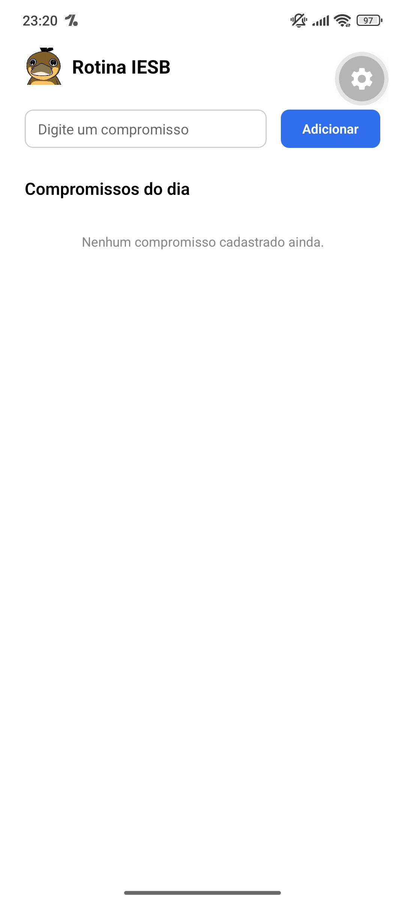
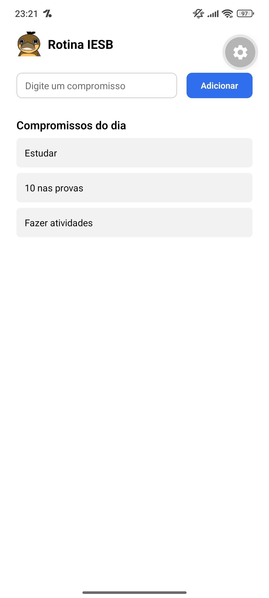
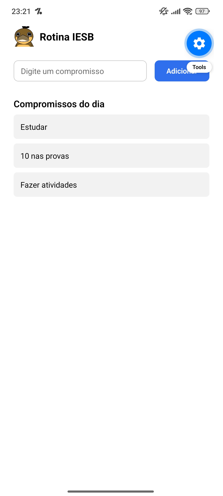

# RotinaIESB

Atividade 03 — integradora das Aulas 02 a 06
Disciplina: Programação para Dispositivos Móveis (React Native / Expo) — IESB

Branch desta entrega: `feature/atividade03`

## Comando usado para criar o projeto

```bash
npx create-expo-app@latest RotinaIESB --template blank
```

## Dependências extras

```bash
npx expo install @react-native-async-storage/async-storage react-native-safe-area-context
```

## Como rodar

```bash
cd RotinaIESB
npx expo start
```

## Arquivos criados em components/ e labels.js

- **labels.js** — rótulos de texto (`tituloApp`, `placeholderCompromisso`,
  `botaoAdicionar`, `tituloLista`, `listaVazia`) exportados como constantes
  nomeadas e importados em `App.js` com `import * as labels from './labels'`.
  Também guarda `categorias` e `categoriaLabels`, usados só na versão com
  desafio opcional.
- **components/CompromissoInput.js** — `TextInput` (~68% de largura) +
  `Pressable` de adicionar (~28%). Props: `value`, `onChangeText`, `onAdd`,
  `labels`.
- **components/CompromissoList.js** — `FlatList` dos compromissos, com
  `Pressable` + `android_ripple` pra remover. Props: `itens`, `onDelete`,
  `tituloLista`, `listaVazia`.
- **components/CompromissoInput.opcional.js** e
  **components/CompromissoList.opcional.js** — versões com os desafios
  extras (ver seção abaixo).
- **assets/logo.png** — ícone simples gerado como placeholder do cabeçalho;
  troque pela logo do IESB ou por um ícone seu se preferir.

## Onde está cada useEffect (persistência) — em App.js

- **useEffect de CARGA** (início do componente `App`): roda uma única vez
  (`[]`). Usa `AsyncStorage.getItem('@rotina_iesb_compromissos')` +
  `JSON.parse` pra preencher a lista assim que o app abre.
- **useEffect de SALVAMENTO** (logo abaixo): roda toda vez que
  `compromissos` muda (`[compromissos, carregado]`). Usa
  `AsyncStorage.setItem` + `JSON.stringify`. Só salva depois que
  `carregado` vira `true`, pra não sobrescrever o storage com uma lista
  vazia antes da carga inicial terminar.

## Prints




